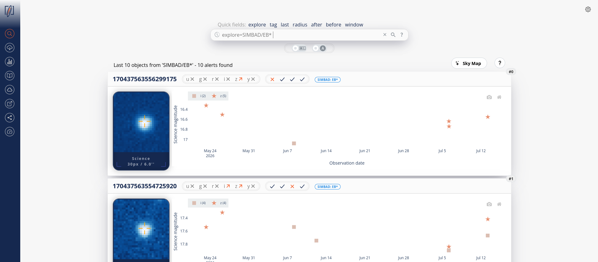

You can now explore the LSST alert data set through cataloged objects in one click.
<!--more-->

The [Fink/LSST science portal](https://lsst.fink-portal.org/) now has a new keyword `explore` to search for cataloged objects in the dataset. The list includes objects with a match in the SIMBAD database, TNS and VSX catalogs, and the Minor Planet Center database. This is only for exploration: every night, we pick up to 10 alerts per catalog class, and expose them. So the results change frequently as the observatory makes new observations (including new clases, and new objects). Note that the [API](https://api.lsst.fink-portal.org/) contains also a new endpoint `/api/v1/explore` if you want to access this data programmatically.
